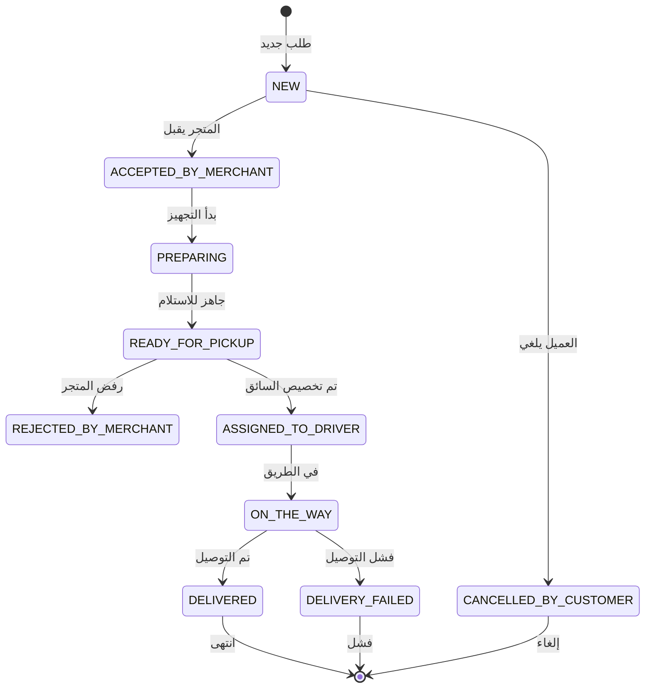

# دراسة تفصيلية للمشروع: سوق السويداء
## Suwayda Marketplace - Detailed Project Study

---

## ملخص المشروع

**سوق السويداء** هو منصة إلكترونية متعددة المتاجر تربط المتاجر المحلية في محافظة السويداء (سوريا) بالعملاء من خلال شبكة التوصيل. تم تطوير المنصة على مراحل حتى إنتهاء الـ Phase 4، مع بنية تحتية متكاملة ووظائف متقدمة.

---

## 1. رؤية المشروع وإنجازاته

### 🎯 الهدف الأساسي
إنشاء منصة تجارة إلكترونية تلخص ثلاث وظائف رئيسية:
- **بيئة التجارة**: منصة متعددة المتاجر مع فلاتر بحث إبداعية
- **نظام التوصيل**: تتبع الوضع في الوقت الفعلي مع تنبيهات فورية
- **تقييم الموثوقية**: نظام تقييم للمتاجر والسائقين بعد التوصيل

### ✅ ما تم إنجازه حتى الآن (Phase 4 مكتمل)

| المرحلة | التاريخ | القائمة | حالة |
|---------|----------|----------|-------|
| Phase 1 | - | الأساس (Monorepo, Docker, Prisma, Auth) | ✅ مكتمل |
| Phase 2 | - | لوحة المتجر (Products, Offers, Profile) | ✅ مكتمل |
| Phase 3 | - | العميل (Home, Search, Cart, Checkout) | ✅ مكتمل |
| Phase 4 | - | الطلبات والتوصيل | ✅ مكتمل |

---

## 2. البنية التحتية والتقنيات المستخدمة

### الواجهة الأمامية (Frontend)

| المكون | الوصف | الحالة |
|---------|--------|---------|
| **إطار العمل** | Next.js 14 App Router + TypeScript | جاهز ✅ |
| **CSS** | Tailwind CSS مع دعم RTL كامل | مُُنفَّذ ✅ |
| **إدارة البيانات** | React Query v5 | مُُنفَّذ ✅ |
| **اللغة** | عربية كاملة RTL | مُنفَّذ ✅ |

#### أجزاء الواجهة المكتملة:

```
frontend/src/app/
├── page.tsx                 # الصفحة الرئيسية
├── products/                # استعراض وبحث المنتجات
│   └── [id]/page.tsx
├── checkout/                # صفحة الدفع والدعاءة
├── orders/                  # طلبات العميل
│   ├── page.tsx
│   └── [id]/page.tsx        # تفاصيل الطلب مع Timeline
├── addresses/               # إدارة العناوين
├── cart/                    # سلة التسوق
├── merchant/                # لوحة المتجر
│   ├── page.tsx
│   └── orders/page.tsx      # طلبات المتجر
├── driver/                  # لوحة السائق (قيد التطوير)
│   └── dashboard/page.tsx
├── admin/                   # لوحة الإدارة
│   └── page.tsx
└── auth/                    # صفحات الدخول/التسجيل

frontend/src/components/
├── StatusBadge.tsx          # شارة الحالة (أخضر/أحمر/برتقالي)
├── ReviewModal.tsx          # نافذة التقييم بعد التوصيل
├── OrderTimeline.tsx        # خط الزمن للطلب
├── OrderItem.tsx            # عنصر الطلب
└── AddressForm.tsx          # نموذج العنوان
```

### الواجهة الخلفية (Backend)

| المكون | الوصف | الحالة |
|---------|--------|---------|
| **اللغة** | Node.js + TypeScript | جاهز ✅ |
| **إطار العمل** | Express.js | مُنفَّذ ✅ |
| **قاعدة البيانات** | PostgreSQL + Prisma ORM | مُُنفَّذ ✅ |
| **المصادقة** | JWT (Access + Refresh) | مُنفَّذ ✅ |
| **التوثيق** | RBAC (ADMIN, MERCHANT, CUSTOMER, DRIVER) | مُنفَّذ ✅ |

#### وحدات النظام المكتملة:

```
backend/src/modules/
├── auth/                    # تسجيل الدخول، التسجيل، JWT
├── users/                   # إدارة المستخدمين
├── stores/                  # إدارة المتاجر (بعد الموافقة)
├── categories/              # الفئات مع دعم الهرمية
├── products/                # المنتجات مع صور WebP
├── offers/                  # العروض والخصومات
├── cart/                    # سلة التسوق مع تقسيم المتاجر
├── orders/                  # نظام حالة الطلب (STATE MACHINE)
├── deliveries/              # توصيلات السائقين
├── payments/                # طرق الدفع (النقد عند التوصيل)
├── notifications/           # الإشعاعات الداخلية
└── admin/                   # لوحة الإدارة
```

---

## 3. نموذج حالة الطلب (Order State Machine)



**التحقق من الصلاحية:**
- كل انتقال يتم توثيقه في `order_status_history`
- الحالات مُحمية بواسطة middleware `requireRole`
- منع التغييرات غير المصرح بها حسب الدور

---

## 4. بنية قاعدة البيانات (Prisma Schema)

### الكبتينات الرئيسية:

| الجدول | الحقول المهمة | العلاقات |
|---------|---------------|----------|
| **users** | id, phone, passwordHash, role | stores, orders, notifications |
| **stores** | id, name, status, workingHours | products, orders, reviews |
| **products** | id, name, price, stock | images, offers, orderItems |
| **orders** | id, status, total, addressSnapshot | items, statusHistory, deliveries |
| **deliveries** | id, driverId, orderId | driver, order |
| **notifications** | id, type, isRead, title, body | user |
| **reviews** | id, storeRating, driverRating, comment | order, store |

### ملاحظات هامة:
- **السعر والبيانات تُقتبس** في orderItems لضمان توثيق الفاتورة
- **الحذف الناعم** (soft delete) على المتاجر والمنتجات
- **رقم الهاتف فريد** كهوية رئيسية لتسجيل الدخول
- **العمولة**: ليرة سورية (SYP) بصيغة عربية

---

## 5. مميزات التصميم والواجهة

### ✅ متطلبات RTL مُنفَّذة:
- `dir="rtl"` و`lang="ar"` في كل صفحة
- Tailwind logical properties (`ms-*`, `me-*`, `ps-*`, `pe-*`)
- اختيار خط عربي واضح

### ✅ التنسيق المالي للعملة:
```typescript
export function formatPrice(amount: number): string {
  return `${new Intl.NumberFormat('ar-SY').format(amount)} ل.س`;
}
```

### ✅ الصورة المُضغوطة:
- تنسيق WebP لتقليل حجم الصور
- دعم رفع متعدد الصور للمنتجات

---

## 6. سيناريوهات المستخدم

### مثال: تدفق مطلوب الطلب
1. **العميل** → يختار منتج، يضيفه للسلة
2. **العميل** → يختار العنوان، يحدد طريقة الدفع (نقد عند التوصيل)
3. **العميل** → يُرسل الطلب (status: NEW)
4. **المتجر** → يقبل أو يرفض الطلب
5. **المتجر** → يبدأ التجهيز، يحدد الجاهزية
6. **المدير** → يخصص سائق للطلب
7. **السائق** → يأخذ الطلب، يوصله للعميل
8. **العميل** → يقيم المتجر بعد التوصيل

---

## 7. القيمة المضافة للعميل

| الميزة | الفائدة |
|--------|----------|
| **إدارة متعددة المتاجر** | متاجر محلية يمكنها بيع منتجاتها بمالها |
| **نظام التوصيل** | توثيق كامل للوقت والمسافة |
| **تقييم المتجر** | بناء ثقة المستهلك مع المتاجر الموثوقة |
| **تنبيهات فورية** | مراقبة فورية لحالة الطلب |
| **واجهة عربية متكاملة** | تجربة مستخدم سهلة باللغة العربية |

---

## 8. التسعير المقترح

### الخطة اقتصادية (الأساسية)
| البند | التكلفة (دولار أمريكي) | ملاحظات |
|-------|------------------------|----------|
| **التطوير الأساسي** | $2,500 - $3,500 | Phase 1-4 مكتمل |
| **إضافة ميزات احترافية** | $1,000 - $1,500 | SSR, PWA, Analytics |
| **اختبار الشامل** | $500 - $800 | وحدة، دمج، أمان |
| **نشر إنتاجي** | $300 - $500 | خادم VPS + HTTPS |
| **صيانة 6 أشهر** | $1,200 | دعم فني شهري |

**التكلفة الإجمالية المقترحة**: $5,000 - $6,300

### نموذج التسعير المقترح

```
| الخدمة | السعر | المدة | المخرجات |
|--------|-------|-------|-----------|
| التطوير الأساسي | $4,500 | 8 أسابيع | منصة جاهزة |
| النشر والتشغيل | $400 | أسبوع | النظام في الإنتاج |
| الدعم والصيانة | $200/شهر | مستمر | تحديثات أمنية |
```

---

## 9. ملاحظات التنفيذ الحالية

### ما تم إنجازه:
- ✅ بنية monorepo متكاملة
- ✅ Docker Compose مع PostgreSQL
- ✅ Prisma schema مُحدث
- ✅ نظام المصادقة والتوثيق (RBAC)
- ✅ واجهة عميل كاملة (RTL)
- ✅ API Endpoints جاهزة
- ✅ نموذج حالة الطلب مُنفَّذ
- ✅ لوحة المتجر والعميل
- ✅ صفحة تفاصيل الطلب مع Timeline
- ✅ نافذة التقييم بعد التوصيل

### ما يتطلب التطوير (Phase 5):
- 🔄 اختبارات شاملة (Unit + Integration)
- 🔄 مراجعة الأمان (Security Audit)
- 🔄 تحسين الأداء (Images, Caching)
- 🔄 دليل النشر (VPS + Nginx + HTTPS)
- 🔄 دعم Web Push Notifications

---

## 10. الخطوات التالية للمفاوضة مع العميل

1. **عرض الدراسة** مع إعادامتها على المشروع
2. **مراجعة القيمة المضافة** من كل مرحلة
3. **اقتراح خطة صيانة** دورية (monthly retainer)
4. **تحديد ميزات إضافية** حسب الميزانية
5. **وضع جدول زمني** للإطلاق النهائي

---

## ملخص قصير للعرض (للعميل)

> "تم إنشاء منصة سوق السويداء المتكاملة بواسطة فريق محترف، حيث تم بناء بنية تحتية قوية باستخدام أحدث التقنيات (Next.js 14 + TypeScript + PostgreSQL). المنصة تدعم 4 أدوار رئيسية (مدير، بائع، عميل، سائق) مع نظام إدارة طلبات متطور. جميع المراحل الأساسية (1-4) مكتملة، مع واجهة عربية كاملة RTL وتنسيق عملة سورية. النتيجة: منصة جاهزة للاستخدام الفوري مع إمكانية توسعة واجهات إضافية."

---

*تم إعداد هذه الدراسة لعرضها على العميل seif@suwayda.ma*
*التاريخ: 2026-11-06*